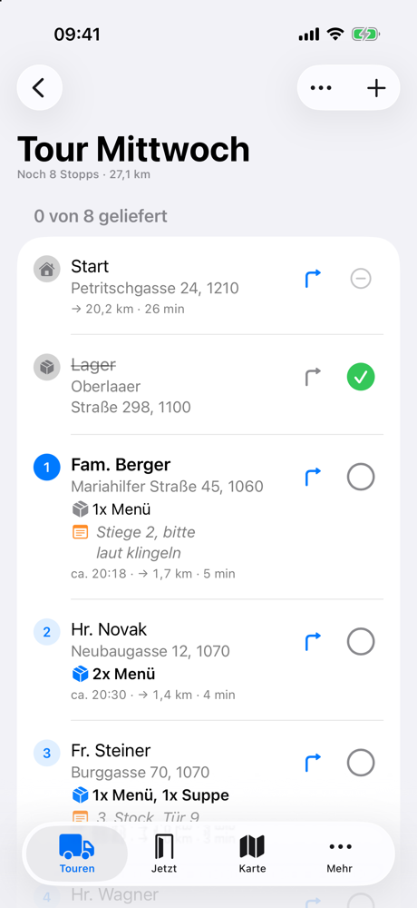
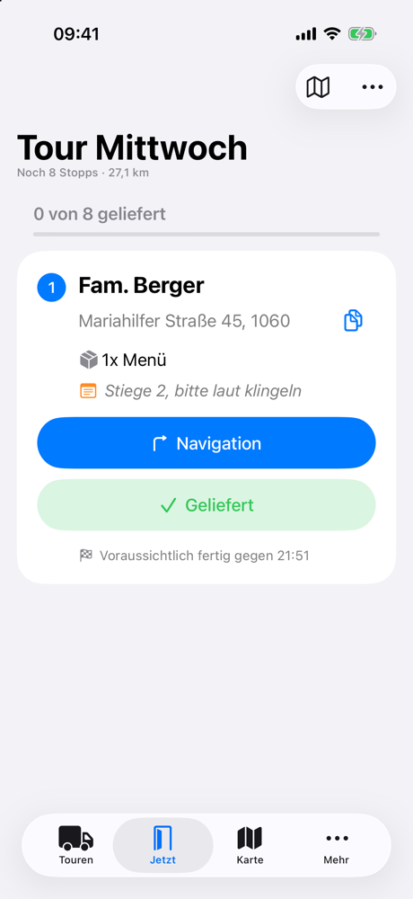
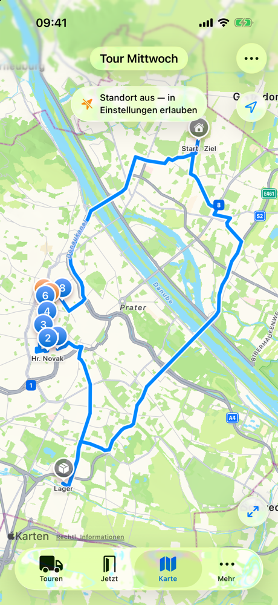
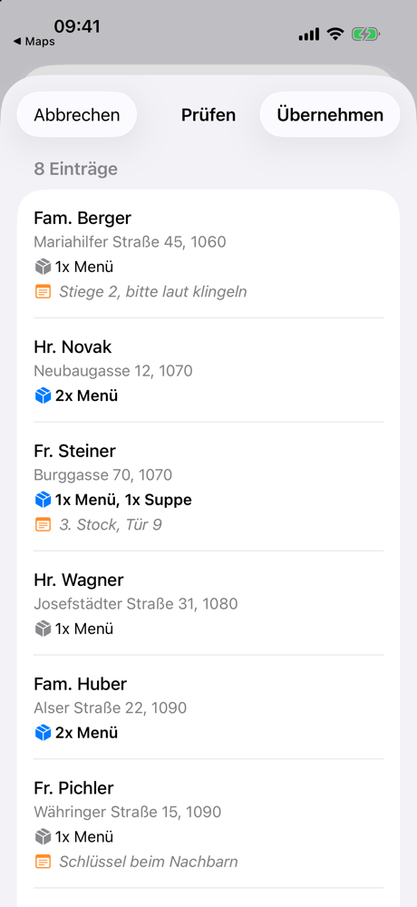

<h1 align="center">EAR Router</h1>

<p align="center">
  <b>Offline-first route planner for a real delivery service.</b><br>
  Built for and used by the drivers of Essen auf Rädern (Meals on Wheels) in Vienna. Native SwiftUI, no third-party dependencies.
</p>

<p align="center">
  <a href="https://github.com/nikolaus018/ear-router/actions/workflows/ci.yml"></a>
  <a href="LICENSE"></a>
  
  
  
</p>

<p align="center">
  
  
  
  
</p>
<p align="center"><sub>Demo data. Tour with arrival estimates, the stop to drive to now, the optimised route, and the import review.</sub></p>

Delivery route planner for *Essen auf Rädern* (Meals on Wheels) in Vienna,
for the Arbeiter-Samariter-Bund Österreichs.

A native iOS app. Tours, stops, delivery status and every floor ever learned
live on the phone; the network is needed only to load a day's tour from the
Zusteller-Portal, to look an address up and to optimise the route.

```
ios/            The app. Open ios/EarRouter.xcodeproj in Xcode.
ios/Tools/      Draws the app icon. Not part of the build.
legacy-web/     The previous Rust + PWA version, kept for reference.
```

## The app

SwiftUI, SwiftData, MapKit. iOS 26, Swift 6 with strict concurrency. No
third-party dependencies.

| | |
|---|---|
| `Model/` | `Route`, `Stop` and `StockwerkNote` — the whole persistent store — plus its versioned schema and the migrations between versions. `Stop` records a `DeliveryOutcome`, not a tick: delivered, bei Nachbarn, nicht angetroffen, abbestellt |
| `Model/RouteSnapshot` | Everything one pass of a stop list needs to know about a tour, worked out in a single walk of its stops — including when the van gets to each remaining door, off the day's own measured pace |
| `Model/Districts` | Vienna's 23 districts, and `Postcodes` — any Austrian PLZ is a valid stop |
| `Services/AddressText` | Address normalisation, Stiege/Parzelle sub-addresses, match keys — and `Search`, the one rule every search field in the app answers to |
| `Services/Geocoder` | Wien OGD → Nominatim cascade, throttled, with wrong-district detection. The city register is only asked about Vienna postcodes; anywhere else in Austria is Nominatim alone |
| `Services/GeocodeCache` | Resolved addresses, and the addresses known not to exist |
| `Services/OSRMClient` | `/route` and `/trip`, with a public-server fallback |
| `Services/RouteOptimizer` | Stop ordering and route geometry |
| `Services/RouteStore` | Every mutation, plus the JSON bulk import |
| `Services/BackupArchive` | The whole store out to one readable JSON file, and back again. Everything here lives on one phone, which is the point of it and also the risk; this is the other half of that deal |
| `Services/SameDoor` | Which stops share a front door |
| `Services/StockwerkStore` | "Globale Infos": what is kept about a customer across every tour — which floor they live on, and whatever the driver wrote down. The things about a delivery that never change and that no list the office sends ever carries: asked once, in the stairwell, and on the row from then on |
| `Services/TourReport` | The day in the form the office has to hear it, plain text, ready to share |
| `Services/Preflight` | The checklist that runs while the van is still in the yard, where every failure this app can have is still cheap |
| `Services/NextStopIntent` | "Hey Siri, nächster Stopp" — read-only, and deliberately so |
| `Services/GourmetPortal` | The Zusteller-Portal: login, the day's tours and their deliveries; the login lives in the Keychain |
| `Support/NavigationHandoff` | Hands a stop to Apple Maps, Waze or Google Maps: a hand-placed pin if there is one, else the house number's entrance from the city's register, else the address. The map pin stays on the building |
| `Support/Theme` | The palette, and why each colour is the colour it is |

### External services

| Service | Used for |
|---|---|
| Zusteller-Portal (`odoo.gourmet.at`) | Loading a day's tour instead of typing it in |
| [Adressservice Wien](https://digitales.wien.gv.at/adressservice-doku) | Primary geocoder — the city's own building register |
| [Nominatim](https://nominatim.openstreetmap.org) | Fallback geocoder. Rate-limited to 1 req/s in `Geocoder` |
| `osrm.ringtwo.win` | Routing and stop-order optimisation. Configurable in Mehr; falls back to the public OSRM demo server |
| Apple MapKit | The map |

### Building

```bash
cd ios
xcodebuild -project EarRouter.xcodeproj -scheme EarRouter \
  -destination 'platform=iOS Simulator,name=iPhone 17' build
```

```bash
cd ios
xcodebuild -project EarRouter.xcodeproj -scheme EarRouter \
  -destination 'platform=iOS Simulator,name=iPhone 17' test
```

### The two schemes

| Scheme | Run builds | For |
|---|---|---|
| `EarRouter` | Debug | Developing. Debugger, incremental builds, `@testable` |
| `EarRouter (Fahrbetrieb)` | Release | Installing the driver's phone |

Installing from Xcode *is* how this app ships — a free developer account signs
a profile good for seven days, so the phone is reinstalled about weekly,
straight from the Run button (see `Support/SideloadExpiry`). Whatever Run
builds is what somebody uses for a week, and Debug means `-Onone`: no
inlining, no generic specialisation, no ARC elision. That is the wrong
build to hand over for the map's per-frame change keys, the union-find behind
"2 an dieser Tür", and the polyline simplification.

So: develop with `EarRouter`, and reinstall the van's phone with
`EarRouter (Fahrbetrieb)`. Tests run under Debug in both, which is where
`ENABLE_TESTABILITY` lives.

## legacy-web

The web version: a Rust (Axum + SQLite) server and the single-file PWA it
serves. It is the foolproof one — for a driver who should not have to learn
anything. Stops come from the Zusteller-Portal or are typed in one at a time,
and nothing in it is more technical than a postcode.

| | |
|---|---|
| Touren | Active tours and, under them, the finished ones. "+" asks where the stops come from: *Von Gourmet laden* (sign in once, pick the day's tour, untick anybody not driven, look the list over in *Prüfen*) or *Leere Tour* |
| An address that is not found | Never becomes a stop at the middle of its district. The form comes back saying so, to be corrected; the map, to put the pin on the house by hand, is the second way out. A tour that still has such a stop from before is not planned and not driven until it is fixed |
| A tour | The stops in driving order with their arrival times; tap one for *Nicht angetroffen*, *Ins Lager mitnehmen*, *Bearbeiten*, *Aus der Tour entfernen*. *Tour vorbereiten* checks it over before the yard is left |
| Jetzt | The stop the driver is at: Navigation (a hand-placed pin, else the house entrance from the city's register, else the address), Geliefert, Anrufen, and a banner that takes the last answer back |
| Ladeliste | VM sums the Pakete; TK lists the customers, last door first. The switch is kept with the tour and decides what every row shows for the Paket |
| Karte | The tour on the map |
| Closing a tour | The Tagesabschluss, ready to send to the office |

Everybody signs in. Each account has its own tours and its own portal login,
kept on its row in `users`; the server does the talking to `odoo.gourmet.at`,
because a browser cannot. The account `admin` — its password is the
environment variable `EAR_ADMIN_PASSWORD`, applied on start — also has an Admin tab, where the other accounts are made,
renamed, given a new password and deleted.

Not in the web version, on purpose: the JSON editor, Erays Planer, Globale
Infos, the other driver's stops, the toilets, backups, splitting a tour on
the map. Not possible in a browser: Siri, the lock-screen card, CarPlay,
saving a contact.

```bash
cd legacy-web
cargo run --release
```

Serves on port 8000 (`EAR_PORT`). The database, `rerouter.db`, is created next
to the binary. `cargo test` covers the rules the server decides.

## License

MIT, see [`LICENSE`](LICENSE).
